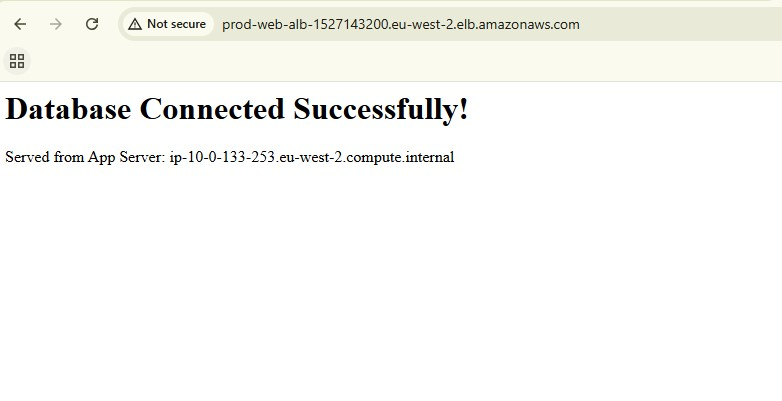
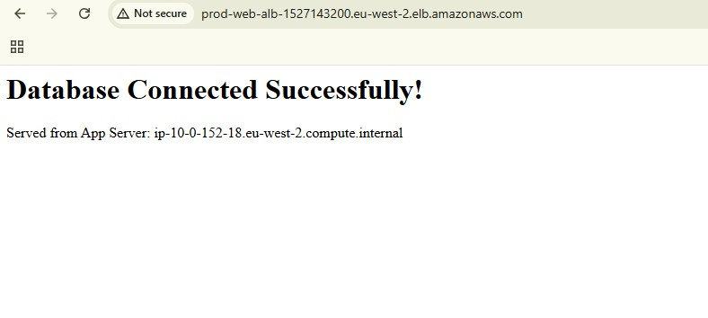

# AWS Production-Grade 3-Tier Web Architecture

A highly available, fault-tolerant, and secure 3-tier web architecture deployed in the AWS London region (`eu-west-2`). This project demonstrates core cloud networking and security principles by separating the presentation, application, and data layers into isolated network segments.

The environment automatically scales based on traffic demands, utilizes an Application Load Balancer for traffic distribution, and leverages a Multi-AZ RDS deployment for database failover redundancy.

## Architecture Topology

* **Region:** `eu-west-2` (London)
* **VPC CIDR:** `10.0.0.0/16`
* **Availability Zones:** `eu-west-2a`, `eu-west-2b`
* **Subnet Partitioning:**
* 2x Public Subnets (Presentation Tier) - `/20`
* 2x Private App Subnets (Application Tier) - `/20`
* 2x Private DB Subnets (Data Tier) - `/20`

## Core Technologies Used

* **Compute:** Amazon EC2 (Amazon Linux 2023), Auto Scaling Groups, Launch Templates
* **Networking:** Amazon VPC, Internet Gateway, NAT Gateways, Application Load Balancer (ALB)
* **Database:** Amazon RDS (MySQL 8.0, Multi-AZ)
* **Security:** Chained Security Groups, IAM Roles, AWS Systems Manager (Session Manager)
* **Application Stack:** Apache (httpd), PHP, MySQLi

## Security & Network Design

This architecture enforces strict network isolation and the principle of least privilege:

1. **Public Tier:** Only the Application Load Balancer (ALB) and NAT Gateways reside in the public subnets. They possess auto-assigned public IPs and route directly to the Internet Gateway.
2. **Private App Tier:** EC2 instances reside in private subnets with no direct inbound internet access. Outbound internet access (for package updates like Apache/PHP) is strictly routed through the NAT Gateways.
3. **Private Data Tier:** The RDS database subnets are completely isolated. Their route tables contain only local VPC routes, with the NAT Gateway routes explicitly removed to guarantee no internet egress.
4. **Chained Security Groups:**
* `prod-alb-sg`: Accepts HTTP (Port 80) from `0.0.0.0/0`.
* `prod-app-sg`: Accepts HTTP (Port 80) **only** from `prod-alb-sg`.
* `prod-db-sg`: Accepts MySQL (Port 3306) **only** from `prod-app-sg`.

## Deployment Phases

### Phase 1: Network Foundation

Built the base VPC using a 1-to-1 route table mapping for the private tiers to ensure granular routing control. Provisioned the Internet Gateway and deployed NAT Gateways into each public subnet for Multi-AZ egress redundancy.

### Phase 2: Compute & Load Balancing

Configured the chained security groups. Created an EC2 Launch Template (`t2.micro`) utilizing a User Data script to bootstrap the Apache server and inject a dynamic PHP script for database connection testing. Provisioned the internet-facing Application Load Balancer and Target Group.

### Phase 3: Data Tier & Auto Scaling

Created a dedicated DB Subnet Group and deployed a Multi-AZ RDS MySQL database to ensure synchronous standby replication. Deployed the Auto Scaling Group (ASG) into the private app subnets, configured with Target Tracking scaling policies (50% CPU utilization) and ELB health checks for automated instance replacement.

## Proof of Functionality

### 1. Load Balancing & Target Health

The ASG successfully provisions instances into the private subnets. The instances successfully communicate outbound via NAT Gateways to install PHP/Apache, and the ALB successfully routes inbound health checks to them.

### 2. High Availability & Dynamic Database Connection

The PHP application dynamically queries the Multi-AZ RDS database and fetches the EC2 internal hostname. Refreshing the ALB DNS URL demonstrates round-robin traffic distribution across different underlying web servers in multiple Availability Zones.

## Future Enhancements

* **Amazon Route 53 & ACM:** Register a custom domain name to route to the ALB and attach an SSL/TLS certificate via AWS Certificate Manager to secure traffic over HTTPS (Port 443).
* **AWS Secrets Manager:** Remove the database password from the EC2 Launch Template User Data script and transition to dynamic credential fetching using an attached IAM instance profile.

---
